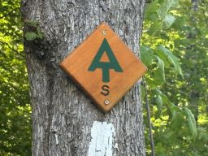

I recently completed a southbound thru hike of the Appalachian Trail. This
page provides notes on my experience in case it helps others. There are 
many good travel logs by AT hikers out there, mostly in video
format. Instead of providing yet another day-by-day account of the trail, I'm 
treating this page like a how-to guide.

There are many ways to have a successful thru hike of the AT. Here I 
document *one way that worked for me*. I'm certainly not claiming that this
is the only way, or even the best way to hike the Trail. This is just one way
that worked for a 58 year-old in reasonably good physical 
condition and with some thru-hiking experience.

You may come up with a much better way. Hike your own hike!

General Overview
----------------

I'm going to assume that you know what the Appalachian Trail 
is about. I hiked southbound (SOBO) starting on July 20 and ending on November 17, 2026. The trail itself was 2,197.7 miles long in 2026. I also hiked for 
a few days in the north prior to my official start (about 50 miles) and did the AT 
approach trail in Amicalola State Park after my official finish (about 9 miles). So total mileage was around 2,260. My hike lasted around 130 days.

There were a few really bad days, but generally speaking I enjoyed
every minute of this adventure. I would strongly encourage everyone to 
give it a try. The AT will change your life.

Choosing My Route
-----------------

I hiked southbound (SOBO). This decision was mostly driven by scheduling.
I had several other trips/family events scheduled for the first part 
of the summer so my start date was going to be in the second half of July.
At that point in the year a northbound trip is infeasible. I didn't seriously consider a
flip-flop because that option is too complicated for a poor planner like
me. A SOBO journey was the only viable option.

I'm surely biased, but I think late-season SOBO is the best way to hike the AT. This
is argued endlessly on the internet so I won't reiterate. For me the key
advantages of a late-season SOBO hike are:

* Works great for someone with other things going on in the first
part of the summer.
* No bugs.
* Very little humidity.
* If you move quickly, you should be able to finish before significant
snowfalls in the south.
* The hardest sections of the trail are finished early.
* Once you hit Vermont the large crowds are gone.
* Once you hit Massachusetts you are often alone.
* Great fall colors for most of the trip.
* SOBO is faster. It's not a coincidence that the AT FKTs were set going south.
* It's meant to be. It's not a coincidence that the rock at the start 
of the approach trail at Amicalola Falls says "AT Maine to Georgia."
* The SOBO hiker personality type tends to be more focused on hiking
(as opposed to partying), more easy-going, and less prone to fear-mongering
and other trail drama.

If you go SOBO (and you should!):
* Make sure you are in good physical shape with some reasonable hiking experience.
There is very little honeymoon on the trail in Maine. You'll immediately
encounter some long food carries and extremely strenuous climbing.
* Make sure you are comfortable hiking/camping alone. There will be lots of 
NOBO company for the first month or so, but thereafter your trip 
will will be a mostly solitary experience. Given my late start, I didn't 
encounter any other southbounders until New Hampshire. I was camping
alone about 50% of the time in the south. 
* Unless you like the cold, be ready for a relatively fast hike. It's
counter-intuitive for us northerners, but the southern part of the AT gets
cold in late October. You'll spend a lot of time above 5,000 feet (and below freezing) in NC, TN, and GA.

Preparation Notes
-----------------

I saw lots of younger 
hikers who were successful "right off the couch." That wasn't me.

At my age, preparation was critical to success.  A lot of physical training is required, particularly if you 
want to enjoy the trip. I started off in reasonably good shape because my preparation started 
about two years before I stepped onto the trail.

Key elements of my preparations:
* I hiked the VT Long Trail, see below.
* I walked 5-12 miles every day for two years leading up to the hike.  My longer training days were often made up of two walks, one in early
morning and one in the evening before dinner.
* I did basic weight training at a local gym for about 18 months prior to the hike. I 
used weights every other day and rotated through push (arms), pull (arms), and legs. You 
will use your arms a lot on this trip so don't neglect that part of your training. In my view, weight training is the most effective step 
you can take to avoid injury on a long-distance hiking trip, especially for us older folks.
* I read [_Appalachian Trials_](https://www.amazon.com/Appalachian-Trials-Psychological-Emotional-Thru-Hike/dp/0985090103/ref=monarch_sidesheet_title) by Zach Davis. I think this is the best book for 
preparing ones self for the hike. 
* I did a three day shake-down hike prior to starting my hike in Maine.
More below.
* I did a four day pre-hike in Maine as a warm-up prior to my ascent of Mount Katahdin. More below.

My Vermont Long Trail Hike, August 2025
---------------------------------------

I got some great advice which I strongly endorse: _if you are even
remotely considering hiking the Appalachian Trail, hike the Vermont
Long Trail first._ I followed this advice and it made all the difference.
[I documented my Long Trail trip here](https://mackinnon.info/2025/09/01/one-way-north.html). A VT Long Trail thru-hike helps in a few ways:
* The Long Trail lets you figure out whether you even like thru-hiking. A weekend
of backpacking just isn't enough - you need to be on trail for a few weeks
to really understand the ups/downs of the sport. 
* The Long Trail will teach you everything you need to know about gear and logistics.
* If you can complete the Long Trail, you have the physical/mental 
fitness needed to finish the AT - no question about it. Trust me, the terrain in 
northern Vermont is as challenging as anything you'll
encounter on the AT.
* A successful end-to-end hike of the Long Trail gives you a huge
confidence boost.

My AT Shake-Down Hike
---------------------

A week before driving to Maine I did a three day shake-down hike.
I live in New England so I decided to do my shake-down on the AT 
in the White
Mountains. In hind-sight that was a questionable decision, but it
worked out well and increased my chances of success on the AT.

Itinerary:

* I drove to the parking lot at Lafayette Campground and parked my car
in the part of the lot used by overnight hikers. 
* I hiked up the popular Old Bridal Path trail past the Greenleaf Hut and
then up to the summit of Mt. Lafayette to pick up the AT. 
* I hiked
north across Garfield Mountain and a few others mountains in the Presidential Range.
I took long breaks to visit the Galehead and Zealand Falls AMC huts.
* I camped at the Garfield Ridge Campsite on my first night.
* I camped at Ethan Pond on my second night. 
* I met a shuttle driver from the excellent [Notch Hostel](https://notchhostel.com/)
at Crawford Notch on the evening of the third day and shuttled back to
my car at Lafayette.

This was a challenging trail section that provided realistic conditions
to test out my gear, food, and fitness. I was exhausted/sore at the end
of the three days and was glad to have a few days of rest before
driving to Maine. Once was enough so I skipped this section of the AT when walking south on my thru-hike. :-)

My Pre-Hike in Maine
--------------------

I'm a big fan of Baxter State Park and have always enjoyed hiking
in the "back country" north of Mt. Katahdin. I decided to add a few
days to my AT hike in order to completely explore the northern region
of the park. This served as a great warm-up before tackling 
Katahdin on AT start day. It also provided a good way to force some
days of low mileage to ease into my hiking routine. 

One challenge that Baxter Park hikers need to deal with is obtaining
the necessary permits. This required phone calls to the 
Baxter reservation office on consecutive mornings 4 months before your
start date. Fortunately, the north of the park is not heavily traveled
and I was able to get the permits I needed.

I was very fortunate that my wife was willing/able to drive me to Maine
so transportation was relatively easy for me. My pre-hike went like this:

* Drove to a hotel in Bangor to spend night 1. 
* Drove north to Monson, ME to leave two food boxes at the excellent
[Shaw's Hiker Hostel](http://www.shawshikerhostel.com/): one to be received
in the middle of the 100 Mile Wilderness and one to be received at the 
end.
* Drove further north to Abol Bridge Campground to leave a food box for
pickup at the start of the 100 Mile Wilderness. In my experience, this
campground was not particularly "hiker-friendly," but I was able to 
convince them to help me out with this box drop. Your mileage may vary.
* Drove further north to the excellent [Matagamon Wilderness Campground](https://www.matagamon.com/).  Here we rented a cabin for night 2.
* The next morning, made the short drive into the Baxter Park Matagamon Gate, signed-in, and started the hike south through the park.
* Hiked south to the South Branch Pond Campground for night 3. About 10 miles.
* Hiked south to the Russell Pond Campground for night 4. About 12 miles.
* Hiked south to the Nesowadnehunk Field Campground for night 5, including
a long stop at the spectacular Wassataquoik Lake. About 12 miles.
* Hiked south to Katahdin Stream Campground for night 6, including
stops at Ledge Falls (bath and shave), Kidney Pond, and Daicey Pond. About 12 miles, much
along the park tote road.
* The next morning, summited Katahdin to start the AT, then returned to Katahdin Stream Campground
for one more night. About 11 miles.

I had obtained permits for three nights at Katahdin Stream in case of 
bad weather. Fortunately I didn't need all of them.

Importantly, *none of the days in this phase of the trip required more than 12 miles
of hiking*. This start is easy on your legs.

Notes on Pace/Hours
-------------------

The biggest risk on an AT thru-hike is injury due to starting too 
fast. I saw a bunch of people forced off trail due to various repetitive
stress injuries. You need to force yourself to take things easy at
the start.

I didn't do more than 12 miles per day for the first three weeks, including my pre-hike. You need to force yourself to slow down at
the start, especially because you'll be feeling fresh and will be
anxious to start racking up some miles. 

There were some days in southern Maine and New Hampshire where I had
a hard time covering more than 8 miles in a 12 hour hiking day. The
terrain was brutal.

I started to feel much stronger after the White Mountains.

I did my first 20 mile day in Vermont. There were a few very smooth 
days in eastern Vermont (farm country) where I started to test my legs.

By the time I hit Massachusetts I as comfortable walking 20-25 miles 
per day.  Further south I started to make a few 30 mile days when needed
to land at an important waypoint (i.e. reaching a store/restaurant before closing, meeting a shuttle driver on time, getting to a town
a day ahead of schedule just because, etc.).

My longest "normal" day (i.e. repeatable) was 33 miles.

My longest 24-hour period was 48 miles during the AT Four-State
Challenge across MD and WV.

I found it necessary to be up early and hiking during every minute
of daylight. As the days got shorter I almost always hiked for an 
hour or two in the dark in the morning. I disliked hiking in the dark
at night, but sometimes it was unavoidable to reach a suitable campsite.
I found that breaking camp in the dark in the morning was *way* easier
than making camp in the dark at night - thus the morning skew. I 
particularly hated coming into a tent/shelter site in the dark and 
not being able to quickly locate the water source and/or bear box.

I took a 30 minute break at lunch. I tried to avoid any other significant
breaks during the day, aside from drawing water. I tried to eat snacks/drink water while moving.

I took the steep uphills and steep downhills very slowly. 

My "planning pace" for a typical day's milestones was 2.5 miles per hour. 
There were very few days that ended up faster/slower than that pace.

I tried to avoid setting my milage goal (i.e. campsite for the night)
until after lunch. I found that having maximum flexibility during the day improved my mental state and reduced the chances of "falling short" for
the day.

My "planning pace" for resupplies was 20 miles per day. Mentally, I found
it helpful to supply for 4 20-mile days and then try to finish the stretch
in 3 days.  Finishing a food carry a day early provided me with a huge
mental boost. This approach provided a good margin in case something went
wrong - I never ran out of food on the trail.

I tried to minimize the number of zero days on the trail. I did NEROs
into towns frequently.

I rarely hiked directly with others. It was better to hike at my
own pace at all times. My "own pace" varied across the day. That said,
in the few cases that I hiked with other people the milage went by 
very quickly given the interesting/free-ranging conversations 
that would inevitably come up on trail. :-)

I tried to avoid injury/illness. Both can cost days off trail.

You'll hear this advice often and it's true: "fast" hikers don't walk
fast, they just walk for more hours.

Zero Days
---------

Zero days are important for recovery, both physical and mental.
Take your zeroes even if you are trying to move quickly - it pays
off in the long run. I took 10 full zero days (i.e. no hiking) at these places:

* Shaw's Hiker Hostel, Monson, ME. Recovery from the 100 Mile Wilderness.
* The Libby Hostel, Gorham, NH. Rest before hitting the Whites.
* Lake of the Clouds Hut, Mt. Washington, NH. Unexpected bad weather day in an exposed area.
* The Mt. Washington Hotel, Crawford Notch, NH. Nice weekend off with Laura.
* Hampton Inn Hotel, Stroudsburg, PA. Needed a mental break. 
* Home, while passing close from the trail in New York. Home for a previously scheduled eye-doctor appointment and to visit family.
* The White Tree Inn, Buena Vista, VA. Unexpected zero to dodge hurricane Isaias.
* Day off to attend the Virginia Tech vs. Georgia Tech football game 
with my son, Blacksburg, VA.
* The Appalachian Trailer, Hot Springs, NC. Double zero rest before 
entering the Great Smoky Mountain National Park.

Nights Off Trail
----------------

On average, I got off trail for the night every 4.5 days. That provided
a very good balance between making miles south and having a break for a 
hot shower and a good meal. I also used these trips off trail to resupply.

I really liked all of the places I stayed so I can recommend all of the following
without reservation. A few of these place were more "primitive" than 
others, but compared to 
sleeping in my tent all nights off trail felt luxurious. 

My advice to hikers: 
* I didn't appreciate this before I left, but the AT hiker hostels
are generally a great experience. A lot of trail culture is embodied in the hostels. In general, hostels are better equipped to accommodate hikers than hotels. For example: try drying a wet tent
at a nice hotel. 
* Do some homework before staying at a random hostel
on trail. There are some really bad (possibly dangerous) ones that you want to avoid. I'm 
not going to get into those details - you can figure it out by talking
to the hikers moving in the opposite direction. Be careful out there.
* FarOut is great, but it only lists the hotels that have specifically
registered themselves. There are sometimes better places to stay that aren't in FarOut.

I spent the night at each of these places:

* Shaw's Hiker Hostel, Monson, ME.
* The Sterling Inn, Caratunk, ME.
* The Sugarloaf Resort, Stratton, ME.
* Pine Ellis Hiker Hostel, Andover, ME.
* AMC Lake of the Clouds Hut, Mt. Washington, NH. 
* AMC Mizpah Spring Hut, Mt. Pierce, NH.
* The Mt. Washington Hotel, Crawford Notch, NH.
* The Notch Hostel, Franconia Notch, NH.
* Hampton Inn Hotel, Manchester Center, VT.
* Hotel Downstreet, North Adams, MA.
* Home, while passing through New York.
* AMC Mohican Outdoor Center, PA.
* Holiday Inn Express outside of Duncannon, PA.
* Hampton Inn Hotel, Stroudsburg, PA. 
* Ironmaster's Mansion Hostel, Pine Grove Furnace State Park, PA.  
* Stay-At-Swatara Hostel, Jonestown, PA.
* Quality Inn, Harpers Ferry, WV.
* PATC Bear's Den Hostel, Virginia Roller Coaster, VA.
* The White Tree Inn, Buena Vista, VA.
* Four Pines Hostel, VA.
* Woods Hole Hostel, Pearisburg, VA.
* Merry Inn Hiker Hostel, Marion, VA.
* The Broken Fiddle, Damascus, VA.
* Boots Off Hostel, Hampton, TN.
* Uncle Johnny's Hostel, Erwin, TN.
* The Appalachian Trailer Hostel, Hot Springs, NC. 
* Rambling Roots Hostel, Bryson City, NC
* Green Dragon Hostel, Hiawassee, GA
* Above the Clouds Hostel, Suches, GA
* The Amicalola Lodge, Amicalola State Park, GA

Nights On Trail
---------------

I slept on trail about 95 nights. Most of the time I slept in 
my tent (Zpacks Solo Plex 1P). I usually camped at established 
shelter or tent sites because flat tent spots were easier to find 
in those places. 

I slept in shelters about 8 times:
* Three nights in the Smokies where it is mandated.
* The other times during severe whether.

I stealth-camped (i.e. random spot in the woods) about 25 nights. This
generally happened in cases where I was too tired to make it to a 
more established site or when an exceptionally cool spot was seen.

I don't have a philosophical problem with the AT shelters, but I generally
got better sleep in my tent due to reduced concerns about drifters,
late-arriving hikers, snoring, mice, and snakes. 

Drifters can be a problem in shelter areas, particularly those built
close to road crossings. I only ran into this twice and it's not
too hard to manage. My advice would be:
* When rolling into a shelter area I never took off my pack until 
I had sized up the crew that was already there. Its very easy to 
say something like "hi, just checking this place out" and keep moving
if the crowd doesn't feel right to you.
* Likewise, I generally avoided unpacking much until just before
bed in case I decided to move along. That said, I never had a case
where I decided to leave after parking for the night.
* Trust your instincts. If the company at a shelter doesn't seem
right, just move on - not a big deal. Sometimes just moving down the 
trail 15 minutes
and setting up at a stealth spot in the woods will result in a 
much better night sleep.

Injuries/Illness
----------------

I'm not a doctor so take all of this for what it's worth. 

On a trip like this, you'll need to know your body well enough
to distinguish between "really injured/sick" and "just very uncomfortable."
I never got injured or sick, but I was very uncomfortable a lot, especially
at the beginning of the hike.

Maybe it's just me, but significant leg/foot pain is inevitable when you are hiking
so many miles over such bad terrain. I rotated through a number of aches and pains, some lasting for days. My strategy was to start every day 
hiking very slowly and to try to hike at a 
pace just below the threshold of any significant discomfort, paying particular attention
to the difference between morning and evening pains. I found that by
"hiking through" my various pains they would eventually go way. If 
you get too worried and/or get off trail for every significant pain 
you'll probably never finish.

Some pains would go away in the afternoon. This generally meant that I 
needed to "warm up" that part of my body more carefully. 

In my opinion, I avoided illness by doing the following:
* Washed hands with soap aggressively, even at lunch breaks. 
* At water sources, moved up stream to the point of inconvenience. Chances
are most people won't bother going up to that spot.
* Never accepted unpackaged foods. It's tempting to take 
burgers, hotdogs, or pancakes from trail angels. I only took bags
of chips and/or drinks.
* Minimized use of the tables at shelters. This is less of an issue
for late-season SOBOs, but noro is a real issue on trail.
* I washed my spoon and pot with boiling water/soap after every meal. 
You are using more gas, but it's worth avoiding illness.
* I used bug-spray (Sawyer Picaridan) to avoid lyme disease. I've heard that DEET is more effective, but that it also dissolves the material that hiking gear is made from.

Random Tips
-----------
* Reflective stuff

MORE TO FOLLOW

