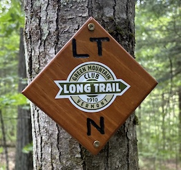

I recently completed a southbound thru hike of the Appalachian Trail. This
page provides notes on my experience in case it helps others. There are 
many good travel logs by AT hikers out there, mostly in video
format. Instead of providing yet another day-by-day account of the trail, I'm 
treating this page like a how-to guide.

There are many ways to have a successful thru hike of the AT. Here I 
document *one way that worked for me*. I'm certainly not claiming that this
is the only way, or even the best way to hike the Trail. This is just one way
that worked for a 58 year-old reasonably good physical 
condition and with some thru-hiking experience.

You may come up with a much better way. Hike your own hike!

General Overview
----------------

I'm going to assume that you know what the Appalachian Trail 
is about. I hiked southbound (SOBO) starting on July 20 and ending on November 17, 2026. The trail itself was 2,197.7 miles in 2026. I also hiked for 
a few days in the north prior to my official start (about 50 miles) and did the AT 
approach trail in Amicalola State Park after my official finish (about 9 miles). So total mileage was around 2,260 and total hiking days was around 130.

Preparation Notes
-----------------

At my age, preparation was critical to success. I saw lots of younger 
hikers who were successful "right off the couch," but that wasn't me.

I got some great advice at some point along the way: _if you are even
remotely considering hiking the Appalachian Trail, hike the Vermont
Long Trail first._ I followed this advice and it made all the difference.
[I documented my Long Trail trip here](2025-09-01-one-way-north.md). The
VT Long Trail hike helps in a few ways:
* You can figure out whether you even like thru-hiking.
* You learn everything you need to know about gear and logistics.
* If you can complete the Long Trail, you have the physical/mental 
fitness needed to finish the AT - no question about it. The terrain in 
the north section of the Long Trail is as challenging as anything you'll
encounter on the AT.

