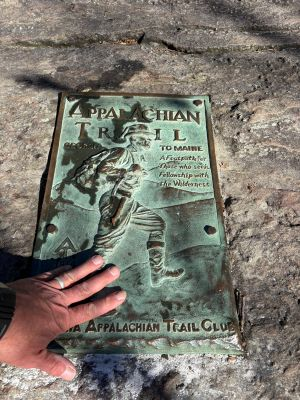

I recently completed a southbound thru hike of the Appalachian Trail. This
page provides notes on my experience in case it helps others. There are 
many good travel logs by AT hikers out there, mostly in video
format. Instead of providing yet another day-by-day account of the trail, I'm 
treating this page like a how-to guide.

There are many ways to have a successful thru hike of the AT. Here I 
document *one way that worked for me*. I'm certainly not claiming that this
is the only way, or even the best way to hike the Trail. This is just one way
that worked for a 58 year-old in reasonably good physical 
condition and with some thru-hiking experience.

You may come up with a much better way. Hike your own hike!

Overview
--------

I'm going to assume that you know what the Appalachian Trail 
is about. I hiked southbound (SOBO) starting on July 20 and finished on November 17, 2026. The Trail was 2,197.7 miles long in 2026. I also hiked for 
a few days in the north prior to my official start (about 50 miles) and did the AT 
approach trail in Amicalola State Park in the south after my official finish (about 9 miles). So my total mileage was around 2,260. My hike lasted around 130 days.
 
I averaged around 17.5 miles per day. I took 10 days off. My daily
mileage started around 10-12 miles per day and ended around 25 miles per day.

There were a few really bad days on trail, but generally speaking I enjoyed
every minute of this adventure. I would strongly encourage everyone to 
give it a try. The AT will change you.

Choosing My Route
-----------------

I hiked southbound (SOBO) starting in Maine. This decision was mostly driven by scheduling.
I had other trips/family events scheduled for the first part 
of the summer so my start date needed to be in the second half of July.
At that point in the year a northbound trip is infeasible. I didn't seriously consider a
flip-flop because that is too complicated for a poor planner like
me. A SOBO journey was the only viable option.

I'm surely biased, but I think late-season SOBO is the best way to hike the AT. This
is argued endlessly on the internet so I won't reiterate. For me the key
advantages of a late-season SOBO hike are:

* Works great for someone with other things going on in the first
part of the summer.
* Very few bugs.
* Very little humidity.
* If you move quickly, you should be able to finish before significant
snowfalls in the south.
* The hardest part of the trail gets finished early.
* Once you hit Vermont the large crowds are gone.
* Once you hit Massachusetts you are often alone.
* Great fall colors for most of the trip.
* SOBO is faster. It's not a coincidence that AT FKTs are usually set going south.
* The trail was meant to be hiked SOBO. It's not a coincidence that the rock at the start 
of the approach trail at Amicalola Falls says "AT Maine to Georgia."
* The SOBO hiker personality type tends to be more focused on hiking
(as opposed to partying), more easy-going, and less prone to fear-mongering
and other trail drama.

If you hike SOBO (and you should!):
* Make sure you are in good physical shape with some reasonable hiking experience.
There is very little honeymoon on the trail in Maine. You'll immediately
encounter some long food carries and extremely strenuous climbing.
* Make sure you are comfortable hiking/camping alone. There will be lots of 
NOBO company for the first month or so, but thereafter your trip 
will will be a mostly solitary experience. Given my late start, I didn't 
encounter any other southbounders until New Hampshire. I was camping
alone about 50% of the time in the south. 
* Unless you like the cold, be ready for a relatively fast hike. It's
counter-intuitive for us northerners, but the southern part of the AT gets
cold in late October. You'll spend a lot of time above 5,000 feet (and below freezing) in NC, TN, and GA. The fear of snow had me up early and hiking south every morning!

Preparation Notes
-----------------

I saw lots of younger 
hikers who were successful "right off the couch." That wasn't me.

At my age (58), preparation was critical to success.  A lot of physical training is required, particularly if you 
want to enjoy the trip. I started off in reasonably good shape because my preparation started 
about two years before I stepped onto the trail.

Key elements of my preparations:
* I hiked the VT Long Trail the summer before, see below.
* I walked 5-12 miles every day for two years leading up to the hike.  My longer training days were often made up of two walks: one in early
morning and one in the evening before dinner.
* I did basic weight training at a local gym for about 18 months prior to the hike. I 
used weights every other day and rotated through push (arms), pull (arms), and legs. You 
will use your arms a lot on this trip so don't neglect that part of your training. In my view, weight training is the most effective step 
you can take to avoid injury on a long-distance hiking trip, especially for us older folks.
* I read [_Appalachian Trials_](https://www.amazon.com/Appalachian-Trials-Psychological-Emotional-Thru-Hike/dp/0985090103/ref=monarch_sidesheet_title) by Zach Davis. I think this is the best book for 
preparing yourself for the hike. 
* I did a three day shake-down hike prior to starting my hike in Maine.
More below.
* I did a four day pre-hike in Maine as a warm-up prior to my ascent of Mount Katahdin. More below.

My Vermont Long Trail Hike, August 2025
---------------------------------------

I got some great advice which I strongly endorse: _if you are even
remotely considering hiking the Appalachian Trail, hike the Vermont
Long Trail first._ I followed this advice and it made all the difference.
[I documented my Long Trail trip here](https://mackinnon.info/2025/09/01/one-way-north.html). A VT Long Trail thru-hike helps in a few ways:
* The Long Trail lets you figure out whether you enjoy thru-hiking. A weekend backpacking trip just isn't enough - you need to be on trail for a few weeks
to really understand the ups/downs of the sport. 
* The Long Trail will teach you everything you need to know about gear and logistics.
* If you can complete the Long Trail, you have the physical/mental 
fitness needed to finish the AT - no question about it. Trust me, the terrain in 
northern Vermont is as challenging as anything you'll
encounter on the AT.
* A successful end-to-end hike of the Long Trail gives you a huge
confidence boost.
* The Long Trail overlaps the AT for 100 miles so you'll build 
some first-hand familiarity with the AT. I purposely timed my
Long Trail hike to overlap the AT NOBO bubble in order to meet and learn from these experienced AT hikers.

My AT Shake-Down Hike
---------------------

A week before driving to Maine I did a three day shake-down hike.
I live in New England so I decided to do my shake-down on the AT 
in the White
Mountains. In hind-sight that was a questionable decision, but it
worked out well and increased my chances of success on the AT.

Itinerary:

* I drove to the parking lot at Lafayette Campground and parked my car
in the part of the lot used by overnight hikers. 
* I hiked up the popular Old Bridal Path trail past the Greenleaf Hut and
then up to the summit of Mt. Lafayette to pick up the AT. 
* I hiked
north across Garfield Mountain and a few others mountains in the Presidential Range.
I took long breaks to visit the Galehead and Zealand Falls AMC huts.
* I camped at the Garfield Ridge Campsite on my first night.
* I camped at Ethan Pond on my second night. 
* I met a shuttle driver from the excellent [Notch Hostel](https://notchhostel.com/)
at Crawford Notch on the evening of the third day and shuttled back to
my car at Lafayette.

This was a challenging trail section that provided realistic conditions
to test out my gear, food, and fitness. I was exhausted/sore at the end
of the three days and was glad to have a few days of rest before
driving to Maine. Once was enough so I skipped this section of the AT when walking south on my thru-hike. :-)

My Pre-Hike in Maine
--------------------

I'm a big fan of Baxter State Park and have always enjoyed hiking
in the "back country" north of Mt. Katahdin. I decided to add a few
days to my AT hike in order to completely explore the northern region
of the park. This served as a great warm-up before tackling 
Katahdin on my official AT start day. It also provided a good way to force some
days of low mileage to ease into my hiking routine. 

One challenge for Baxter Park hikers is obtaining
the necessary permits. This required phone calls to the 
Baxter reservation office on consecutive mornings 4 months before my
start date. Fortunately, the north of the park is not heavily traveled
and I was able to get the permits I needed.

I was very fortunate that my wife was willing/able to drive me to Maine
so transportation was relatively easy for me. My pre-hike went like this:

* Drove to a hotel in Bangor, ME to spend night 1. 
* Drove north to Monson, ME to leave two food boxes at the excellent
[Shaw's Hiker Hostel](http://www.shawshikerhostel.com/): one to be received
in the middle of the 100 Mile Wilderness and one to be received at the 
end.
* Drove further north on the Golden Road to the Abol Bridge Campground to leave a food box for
pickup at the start of the 100 Mile Wilderness. In my experience, this
campground was not particularly "hiker-friendly," but I was able to 
convince them to help me out with this box drop. Your mileage may vary.
* Drove further north to the excellent [Matagamon Wilderness Campground](https://www.matagamon.com/).  Here we rented a cabin for night 2.
* The next morning we made the short drive into the Baxter Park Matagamon Gate, signed-in, and I started my hike south through the park.
* Hiked south to the South Branch Pond Campground for night 3. About 10 miles.
* Hiked south to the Russell Pond Campground for night 4. About 12 miles.
* Hiked south to the Nesowadnehunk Field Campground for night 5, including
a long stop at the spectacular Wassataquoik Lake. About 12 miles.
* Hiked south to Katahdin Stream Campground for night 6, including
stops at Ledge Falls (bath and shave), Kidney Pond, and Daicey Pond. About 12 miles, much
along the park tote road.
* The next morning, summited Katahdin to start the AT, then returned to Katahdin Stream Campground
for my official first night on the AT. About 11 miles.

I had obtained permits for three nights at Katahdin Stream in case of 
bad weather. Fortunately I didn't need all three of them.

Importantly, *none of the days in this phase of the trip required more than 12 miles
of hiking*. This start is easy on your legs.

Notes on My Pace/Hiking Hours
-----------------------------

The biggest risk on an AT thru-hike is injury due to starting too 
fast. I saw a bunch of people forced off trail due to various repetitive
stress injuries. You need to force yourself to slow down at
the start, especially because you'll be feeling fresh and will be
anxious to start racking up some miles. 

I didn't do more than 12 miles per day for the first three weeks, including my pre-hike. 

There were some areas in southern Maine and New Hampshire where I had
a hard time covering more than 8 miles in a 12 hour hiking day. The
terrain was brutal.

The hard miles through Maine and New Hampshire were demoralizing 
at times, particularly given my hope of returning to my family
before Thanksgiving. My advice is: **don't panic**, bigger miles
will come more easily as you get further south. 

I started to feel much stronger after exiting the White Mountains.

I did my first 20 mile day in Vermont. There were a few very smooth 
days in eastern Vermont (farm country) where I started to test my legs.

By the time I hit Massachusetts I as comfortable walking 20-25 miles 
per day.  Further south I started to make a few 30 mile days when needed
to land at an important waypoint (i.e. reaching a store/restaurant before closing, meeting a shuttle driver on time, getting to a town
a day ahead of schedule just because, etc.).

My longest "normal" day (i.e. repeatable) was 33 miles. I think that
day was going into the nice dining room at the Big Meadows Lodge in the 
Shenandoahs. The dinner made it worth it. 

My longest 24-hour period was logged during the AT Four-State
Challenge across PA/MD/WV/VA. I did 48 miles that day but needed to
take a day off to recover. That was fun!

I found it necessary to be up early and moving during every minute
of daylight. As the days got shorter I almost always hiked for an 
hour or two in the dark in the morning. I disliked hiking in the dark
at night, but sometimes it was necessary to reach a suitable campsite.
I found that breaking camp in the dark in the morning was *way* easier
than making camp in the dark at night - thus the morning skew. I 
particularly hated coming into a tent/shelter site in the dark and 
not being able to quickly locate the water source and/or bear box.

I took a 30 minute break at lunch. I tried to avoid any other significant
breaks during the day, aside from drawing water. I tried to eat snacks/drink water while moving.

If I needed to dry out my gear I would take a longer lunch break
at a place with good sun exposure.

I took the steep uphills and steep downhills very slowly. 

My "planning pace" for a typical day's milestones was 2.5 miles per hour. 
There were very few days that ended up faster/slower than that pace.

I tried to avoid setting my daily mileage goal (i.e. campsite for the night)
until after lunch. I found that keeping maximum flexibility during the day improved my mental state and reduced the chances of "falling short" for
the day.

My "planning pace" for resupplies was 20 miles per day. Mentally, I found
it helpful to supply for 4 20-mile days and then try to finish the stretch
in 3 days.  I would often have two sets of routes mapped in FarOut: one conservative set and one "push" set that was more aggressive. Finishing a food carry between towns one day early provided me with a huge
mental boost. Plus, I could eat two days of food on the last day! This approach provided a good margin in case something went
wrong - I never ran out of food on the trail.

A big determinant of daily mileage was the elevation profile of the
day. I tried to avoid days with more than 5,500 feet of vertical gain
or days with a grade of more than 600 feet/mile. Sometimes this was 
impossible to avoid. The most "up" I did in one day was in the Smokies when
I had a day with 8,500 feet of vertical ascent. That was tough going.

I tried to minimize the number of zero days on the trail. I did NERO
days (near zero) into towns frequently and even managed a few HERO
days (no lost mileage) where the trail passed directly through a town.

I rarely hiked directly with others. I found it better to hike at my
own pace at all times. My "own pace" varied across the day. That said,
in the few cases that I hiked with other people the miles went by 
very quickly given the interesting/free-ranging conversations 
that would inevitably come up on trail. :-)

I tried hard to avoid injury/illness. Both can cost days off trail.

You'll hear this advice often and it's true: "fast" hikers don't walk
fast, they just walk for more hours.

Zero Days
---------

Zero days are important for recovery, both physical and mental.
Take your zeroes even if you are trying to move quickly - it pays
off in the long run. I took 10 full zero days (i.e. no hiking) at these places:

* Shaw's Hiker Hostel, Monson, ME. Recovery from the 100 Mile Wilderness.
* The Libby Hostel, Gorham, NH. Rest before hitting the Whites.
* Lake of the Clouds Hut, Mt. Washington, NH. Unexpected bad weather day in an exposed area.
* The Mt. Washington Hotel, Crawford Notch, NH. Nice weekend off with Laura.
* Hampton Inn Hotel, Stroudsburg, PA. Needed a mental break. 
* Home, while passing close from the trail in New York. Home for a previously scheduled eye-doctor appointment and to visit family.
* The White Tree Inn, Buena Vista, VA. Unexpected zero to dodge hurricane Isaias.
* Day off to attend the Virginia Tech vs. Georgia Tech football game 
with my son, Blacksburg, VA.
* The Appalachian Trailer Hostel, Hot Springs, NC. Double zero to rest before 
entering the Great Smoky Mountain National Park.

Nights Off Trail
----------------

On average, I got off trail for the night every 5 days. That provided
a very good balance between making fast miles south and having a break for a 
hot shower and a good meal. I also used these trips off trail to resupply.

I really liked all of the places I stayed so I can recommend all of the following
without hesitation. A few of these place were more primitive than 
others, but compared to 
sleeping in my tent all nights off trail felt luxurious. 

My advice to hikers: 
* I didn't appreciate this before I left, but the AT hiker hostels
are generally a great experience. A lot of trail culture is embodied in the hostels. In general, hostels are better equipped to accommodate hikers than hotels. For example: try drying a wet tent
at a nice hotel. The farther south I got, the more I favored hostels 
over hotels.
* Do some homework before staying at a random hostel
on trail. There are some really bad ones (possibly dangerous) that you want to avoid. I'm 
not going to get into those details - you can figure it out by talking
to the hikers moving in the opposite direction. Be careful out there.
* FarOut is great, but it only lists the hotels that have specifically
registered themselves. There are sometimes better places to stay that aren't listed in FarOut.

I spent the night at each of these places:

* Shaw's Hiker Hostel, Monson, ME.
* The Sterling Inn, Caratunk, ME.
* The Sugarloaf Resort, Stratton, ME.
* Pine Ellis Hiker Hostel, Andover, ME.
* AMC Lake of the Clouds Hut, Mt. Washington, NH. 
* AMC Mizpah Spring Hut, Mt. Pierce, NH.
* The Mt. Washington Hotel, Crawford Notch, NH.
* The Notch Hostel, Franconia Notch, NH.
* Hampton Inn Hotel, Manchester Center, VT.
* Hotel Downstreet, North Adams, MA.
* Home, while passing through New York.
* AMC Mohican Outdoor Center, PA.
* Holiday Inn Express outside of Duncannon, PA.
* Hampton Inn Hotel, Stroudsburg, PA. 
* Ironmaster's Mansion Hostel, Pine Grove Furnace State Park, PA.  
* Stay-At-Swatara Hostel, Jonestown, PA.
* Quality Inn, Harpers Ferry, WV.
* PATC Bear's Den Hostel, Virginia Roller Coaster, VA.
* The White Tree Inn, Buena Vista, VA.
* Four Pines Hostel, VA.
* Woods Hole Hostel, Pearisburg, VA.
* Merry Inn Hiker Hostel, Marion, VA.
* The Broken Fiddle Hostel, Damascus, VA.
* Boots Off Hostel, Hampton, TN.
* Uncle Johnny's Hostel, Erwin, TN.
* The Appalachian Trailer Hostel, Hot Springs, NC. 
* Rambling Roots Hostel, Bryson City, NC
* The Grove Hostel, Franklin, NC
* Green Dragon Hostel, Hiawassee, GA
* Above the Clouds Hostel, Suches, GA
* The Amicalola Lodge, Amicalola State Park, GA

Nights On Trail
---------------

I slept on trail about 95 nights. Most of the time I slept in 
my tent (Zpacks Solo Plex 1P). I usually camped at an established 
shelter or tent sites because flat tent spots were easier to find 
in those places. It's very important to find a stopping point that will result
in a good night sleep. Your body needs sleep to recover from a long 
day of hiking.

I slept in shelters about 8 times:
* Three nights in the Smokies where it is mandated.
* The other times during severe whether.

I stealth-camped (i.e. random spot in the woods) about 25 nights. This
generally happened in cases where I was too tired to make it to a 
more established site or when an exceptionally good spot was seen
along the trail.

I don't have a philosophical problem with the AT shelters, but I generally
got better sleep in my tent due to reduced concerns about drifters,
late-arriving hikers, snoring, mice, and snakes. 

Drifters and/or folks with mental problems can occasionally be a 
problem in shelter areas, particularly those built very
close to road crossings. I only ran into this twice and it's not
too hard to manage. My advice would be:
* All other things being equal, I avoided shelters and campsites that 
were close to a road.
* When rolling into a shelter area I never took off my pack until 
I had sized up the crew that was already there. It's very easy to 
say something like "hi, just checking this place out" and keep moving
if the crowd doesn't feel right to you.
* Likewise, I generally avoided unpacking much until just before
bed in case I decided later to move along. That said, I never had a case
where I decided to leave after parking for the night.
* Trust your instincts. If the company at a shelter doesn't seem
right, just move on - it's not a big deal. Sometimes just moving down the 
trail 15 minutes
and setting up at a stealth spot in the woods will result in a 
much better nights sleep.

It's interesting to see that the trail authorities are working on 
demolishing a few "non-conformant" shelters that are less than 1 mile 
from a road. I'm assuming this is being done to manage the issue
of non-hikers living in the AT shelters.

Getting Around
--------------

There were cases where I needed a ride to get into town. A few 
notes from my experience:
* Hitchhiking was pretty easy at major trail crossings. The 
locals knew about the trail and many seemed to enjoy picking up 
hikers.
* Local shuttles were a good way to provide more certainty. The
local shuttle drivers also knew the ins/outs of AT road crossings,
some of which are obscure US Forest Service Roads that wouldn't be
familiar to "normal" people. 
* Uber actually worked in some places on the trail.
* Outfitters always maintained a list of local shuttles/taxis.
* The best way to find out about good shuttle drivers was through
references from other shuttle drivers. Each shuttle driver generally
has a territory that they can cover in a cost-effective way. I 
found that they knew exactly who the good drivers were to the 
immediate south of 
them and were happy to share contact information. These relationships 
are reciprocal since the drivers to the south do the same to hand
NOBO hikers up the trail. I think I started this chain in PA and used
the recommendations all the way to GA.

Injuries/Illness
----------------

I'm not a doctor so take all of this for what it's worth. 

On a trip like this, you'll need to know your body well enough
to distinguish between "really injured/sick" and "just very uncomfortable."
I never got injured or sick, but I was very uncomfortable a lot, especially
at the beginning of the hike.

Maybe it's just me, but significant leg/foot pain is inevitable when you are hiking
so many miles over such bad terrain. I rotated through a number of aches and pains, some lasting for days. My strategy was to start every day 
hiking very slowly and to try to hike at a 
pace just below the threshold of any significant discomfort, paying particular attention
to the difference between morning and evening pains. I found that by
"hiking through" my various pains they would eventually go way. If 
you get too worried and/or get off trail for every significant pain 
you'll probably never finish.

Some pains would go away in the afternoon. This generally meant that I 
needed to "warm up" that part of my body more carefully. 

I fell a bunch of times. A few things I noticed:
* Falls were most common when setting out immediately after a stop of some kind. I needed to force myself to get going slowly 
after a stop.
* Blue blazes and/or awkward hikes down to water sources were the 
most dangerous, probably because I didn't always approach these
places with the same care as the "real trail."
* I found that listening to music/podcasts/books could distract me
from being careful about footing. I needed to walk in silence in very 
uneven/tangled terrain. This is a classic "walking a chewing gum at the same time" problem. When the treadway became easier in the south
I was able to listen to audio books more safely.

Giardia, food poisoning, and lyme disease are real threats 
on the trail - much more dangerous than bears or snakes.
I encountered hikers with all of these ailments. Norovirus is 
more of a problem
for the early-season NOBOs and I never saw that on my trip.

In my opinion, I avoided illness by doing the following:
* Washed hands with soap aggressively, even at lunch breaks. 
* At water sources, moved up stream to the point of inconvenience. Chances
are most people won't bother going up to that spot.
* Never accepted unpackaged foods. It's tempting to take 
burgers, hotdogs, or pancakes from trail angels. I only took bags
of chips and/or drinks.
* Minimized use of the tables at shelters. This is less of an issue
for late-season SOBOs, but noro is a real issue on trail.
* I washed my spoon and pot with boiling water/soap after every meal. 
You are using more gas, but it's worth avoiding illness.
* I used bug-spray (Sawyer Picaridan) to avoid lyme disease. I've heard that DEET is more effective, but that it also dissolves the material that hiking gear is made from.

Food
----

I've heard it said: the main challenge of the first third of the trail
is physical, the second third is mental, and the last third is 
nutritional. This was completely true in my case. It's hard to provide
general advice on this topic because everyone's body is different, but
I had all of the usual food problems on the trail.

After a few months on trail my fitness was no longer a limiting 
factor. I could hike for 24 hours if desired. Instead, my limit was
calories. I would often feel myself "running out of gas" towards
the end of the day. Any time I was lucky enough to pass a store, deli,
coffee shop, or gas station the extra mileage gained
as a result of the "calorie boost" was significant. I first discovered
this after stopping at the AT-favorite Abracadabra Coffee Co. in
Woodstock, VT. After two ice creams and a donut I felt like superman. I walked another 15 miles into the night after that afternoon food stop.

Food carry is a fine balance. Too little and you need to stop in town 
constantly. Too much and you're too heavy to hike. I found the sweet spot for me was between three and four days of carry. There were some places
(100 Mile Wilderness, Smokies, NJ) where 6 days was required due 
to lack of resupply options.

I resupplied from stores about half the time and received supply boxes about half the time. I really liked the resupply boxes because of their
efficiency, but this required someone who is willing/able to do the work
to pack/send them. I was lucky that my wife was willing to do this.

During some parts of my trip I found it was better to cook my high-calorie 
dinner at lunch time and eat my lunch in the evening before bed. This
gave me some more energy for hiking during the afternoon.

I alternated between packaged backpacking meals (Mountain House, Peak, etc.) and homemade bags of dried food.

Random food notes:
* I had very good luck using the [Greenbelly Meals 2Go](https://www.greenbelly.co/) snacks. 700 calories in one shot in the afternoon.
* I ate a lot of Snickers bars.
* I ate a lot of Cliff Builder protein bars.
* I ate a lot of fig bars.
* I ate a lot of Carnation Breakfast Essentials.
* It's better to eat small amounts at a time continuously 
through the day.
* My favorite homemade breakfast packet:
  - Oatmeal
  - Powdered milk
  - Flax seed
  - Freeze-dried blueberries
* Most lunches:
  - Tuna or chicken packet
  - Mayo
  - Cholula hot sauce
  - Tortilla
* My favorite homemade dinner packet (ala Andrew Skurka):
  - Freeze dried refried beans
  - Rice 
  - Taco seasoning
  - Cheese
  - Chips

Whenever in town I forced myself to eat a lot. Seriously.

I carried a bear canister (BV450) most of the trip. I would do the same
again. It was very nice not to be fooling around with marginal bear
hangs at night after a long day of hiking. I slept better not having to
worry about mice/critters. There were places in the south where I don't
think there were any suitable branches for bear hangs, especially in 
the dense rhododendron forests.

Ironically, I sent my bear canister home just before entering GA. Now
GA is the only state that requires them to be carried at all times.

I carried a stove and cooked hot meals for all breakfasts and dinners. To
me, the extra weight was well worth it. A hot meal is good for your
mental health, especially on a cold and/or rainy day. Resupplying isobutane canisters
on the trail was very easy.

All this said, I was under-caloried and lost about 40 pounds during 
my trip. Not ideal.

Water
-----

I had some problems with water supply given the drought that 
was going on in PA and VA during my hike. Any time I passed 
a usable source in a dry area I would "camel up" (i.e. drink a 
liter) and then collect at least 1.7L to carry. If it looked 
like there wasn't going to be water at my target campsite I would
carry a second liter in reserve. 2.7L of water weighs around
6 pounds so this was a major pain in the back.

I used a Sawyer Squeeze filter and a 2L CNOC water bladder. These
were very common on trail. I also
made a scoop by cutting off the bottom of a 12oz plastic 
Coke bottle. In the south a scoop became critical because there were many
water sources that were too shallow to fill up a CNOC directly.
Sometimes I even collected water from "seeping" sources, so a thin,
rigid scoop was extremely useful.

I backflushed my filter in a sink (blue coupler) every time I slept 
off trail and never had a problem with the filtering becoming slow.

I started off carrying 1L and 700mL Smartwater bottles. I carried
the 700mL bottle in a front bottle holder for easy access during
the day.  Once I got 
to PA and the drought became a bigger issue
I added a second 1L Smartwater bottle for longer carries. One good feature
of the HMG Southwest pack is the large side pockets that can
hold two 1L Smartwater bottles close to your back. I never carried
water in my CNOC.

Don't count on water caches, particularly for late-season
SOBO hikes. I passed a lot of empty jugs in the south. I 
think I only found two useful water caches on my entire hike.

Pay close attention to the water commentary 
in FarOut and, when in doubt, carry some extra. The mental 
tax of worrying about being thirsty is high so carrying a bit 
of extra makes the day much more enjoyable.

Filter all water, no matter where it comes from. I always filtered 
the bottled water from caches.

Once it gets cold, don't forget to sleep with your water filter and carry it on your
body. A Sawyer filter that has frozen is ineffective.

The Mental Game
---------------

Many have said this before: a multi-month hiking trip is more
mental than physical. I would generally agree. 

One of the things that Zach Davis stresses in his _Appalachian Trials_
book is the importance of having a clear "reason why" for your trip before 
you leave. He argues that the novelty of the hiking experience will 
wear off after a few weeks and, when things get bad, hikers who don't 
have a strong reason for being on trail will often quit. It's a voluntary 
activity and there's nothing *really forcing you* to stay out there.
Zach goes so far as to suggest that you should write your "why" on a slip of
paper and carry it on your hike to use as a reminder during the inevitable bad
days.

I think this is solid advice. That said, I wasn't able to articulate
a clear reason why I was doing the hike, although I was pretty 
confident that the "why" would reveal itself along the way. Zach's advice notwithstanding, I started my trip whyless. Fortunately, when the bad days
came I never considered quitting. As the trip went on I did
get more clarity on the reasons why I was hiking.  Things all worked out
in the end. 

Be cautious about basing your expectations for the trip on YouTube. There
are some very informative YouTubers/vloggers on the AT, but I feel
like most videos focus on the exciting/entertaining parts of the hike
while skipping the boring/painful/uncomfortable/dangerous parts. The pictures
that I took of my own trip have this same bias. If nothing else,
I didn't want to get my phone wet by taking a picture in the pouring 
rain!

Here are a few tips for dealing with the mental side of an AT hike:

* Take preparation/shake-down seriously. Try to avoid doing anything
for the first time on your actual thru-hike.  
* Don't plan too far ahead - that can become overwhelming. Just focus on
getting to the next water source, the next campsite, and the next
resupply. I'm a bad planner so perhaps this is self-serving, but when
I started planning out a week or two things tended to start 
derailing. Just get yourself to the next campsite! I didn't even
book my flight home until I was less than a week from the finish.
* Always remember that your situation is temporary. The climb
will end. The rain will stop. Your gear will dry. The ache in your 
leg will subside (or at least move to the other leg). You'll meet 
another hiker soon. You'll be in town soon. Hang in there, the
problem will pass.
* I tried to avoid checking on my mileage an/dor elevation
during the day. Constant checking of progress makes the day drag.
* Text chains with family, classmates, friends back home, and 
other hikers on the trail provided a big morale boost. 
* Stretch mileage goals like the Four-State Challenge or the Connecticut 
Challenge are fun ways to break up the routine of the trip.
* Always introduce yourself to others at the shelters/campsites and
make an effort to eat dinner with the group. The human contact (even
with hikers that you know you'll never see again) will help you
to maintain your sanity.
* Be honest with yourself before leaving on your hike: **some days
(or weeks) on trail are really going to suck.** That's just part of 
the experience. Don't be surprised and don't over-react in these
situations.

Gear
----

I'm not a big gear nerd and there is already plenty of material on the internet about AT packing lists so 
I'm not going to list out all of my gear.  Reach out if you care. Suffice to say, 
I am not an ultra-light hiker. From my experience, my base weight of ~16 
pounds put me in the middle of the range of hikers I met along the way. Some had
lighter packs and many had heavier. Lighter is better for sure, but I doubt that 
5 pounds more or less would have made much of a difference in my success/enjoyment.

My "big three" consisted of:
* Hyperlite Mountain Gear 55L Southwest pack (black). This is the most durable 
version of the HMG packs, which is important given the amount of times you'll 
scrape/snag your pack on rocks and trees on the AT. Yes, it's a bit heavier.
I used a nylofume bag to keep things dry inside my pack. I did not
use a pack cover or any "stuff sacks" for the rest of my gear. Everything
that needed to stay dry went into the nylofume and I never 
had a problem with things getting wet, even 
during a few bad rain storms. 
* Zpacks Plex Solo 1P trekking pole tent. This weighs about 14 ounces. This
tent is very small, just barely large enough for a 5' 11" hiker. I 
was comfortable and dry for the entire hike. Condensation was a problem, 
as it would be for any single-wall tent design. The foot box of my 
sleeping quilt was wet almost every morning. It was important to 
keep both vestibule flaps open at all times to maintain good airflow, except during rain.
* Enlightened Equipment Revelation 20 quilt. I switched to the 0 
degree version in Hot Springs, NC. I don't think I was in danger
of exceeding the survival rating of the 20 degree quilt, but I certainly
would have exceeded the comfort rating during the very cold nights 
in the south. The 0 degree quilt was very comfortable and I was glad
to carry the extra weight.
* A silk sleeping bag liner. I switched to a Sea to Summit 
Reactor fleece winter liner in Hot Springs, NC.
* Therm-a-Rest NeoAir NextLite NXT sleeping pad. Comfortable enough, and not too loud.
* Gossamer Gear 1/8" foam pad -  particularly important for protecting your 
fragile sleeping pad from shelter floors. Also a great sit/nap pad.

I was happy with all gear selections and wouldn't change anything.

I see a lot of people online obsessing about UL and pack weights. As my 
wise son pointed out before one of our trips, it might be more productive to improve
your diet and loose 5 pounds off your body than to figure out how to 
loose 5 pounds from your pack.

Electronics
-----------

I carried:
* An iPhone 17 with the FarOut app. 
* A Nitecore NU25 headlamp.
* A Nitecore NB10000 Gen 3 power bank (10,000 mAh capacity)
* A Garmin InReach Mini 2 satellite messenger.
* A cheap Casio wrist watch with an alarm.

I used the ubiquitous FarOut app for navigation. I won't get
into a long description of FarOut because it is covered well
in other places. The most important uses of FarOut:
* Commentary on water sources, particularly through the droughts
in PA and VA.
* Route planning.
* Help getting back on the trail in a few places (less than 10)
where I lost it. 
* Reassurance that I was still on the trail, particularly during night hiking.

When you depend on your phone for navigation it is critical 
to keep it dry. Obviously, you want to avoid submerging the phone. 
However, a more subtle/common problem can occur when a few drops of water
get on the phone's screen. Very often a damp capacitive touch screen becomes temporarily unusable. My solution was to keep my phone in a thin Zip-lock 
whenever it was wet out. The phone could still be used (sort of) through 
the bag. I also carried a bandanna in a separate Zip-lock to dry off
the phone screen if needed. That said, there were two days 
on my trip when I couldn't access FarOut because it was too wet
to use my phone reliably. This could be a significant problem.

After one such failure, I got into the habit of writing down the 
mile numbers of all the water sources and campsites down the track from each resupply stop. This gave me a back-up to use in case that either
my phone wasn't working or it was raining so hard that I didn't
dare pull it out.

I traveled with my phone in low power and airplane modes at all times.

The Garmin InReach Mini worked great for sending daily check-in messages to my family. I also used the Garmin text feature occasionally, but
the satellite messaging feature on the iPhone was generally faster. 
I only turned on my Garmin in the evening for as long as it took to 
transmit the check-in message, download any texts, and download the weather forecast. The battery life on the Garmin is very good. 

The Nitecore NU25 is a great headlamp. I could get around 8 hours of
night hiking on a single charge. The low-power "moonlight" mode was
bright enough for in-camp usage. 

When leaving town with a fully charged phone, headlamp, and power bank
I was able to go about 6 days without running out of power. For 
long stretches (more than 3 days) I tended to be conservative with 
power - mostly by limiting podcast/audio books.

One problem to watch out for: an iPhone will draw from a power
bank as long as it is connected. If you fall asleep while charging
your iPhone you can accidentally drain the bank completely. After 
learning this the hard way I set my alarm during phone charging. The Nitecore
headlamp does not have this problem - it stops drawing power
as soon as it is fully charged.

Random Tips
-----------

* Put some reflective tape on your bear canister, phone case,
and trekking poles. All of these things are easy to lose track 
of in the dark.
* Put some reflective string on the outside of your pack. One time
I almost lost my pack in the dark.
* Put some reflective string on the outside of your tent if not
there already. When getting up at night it's very easy to lose 
track of your tent in the dark. This is even more important when 
it is very foggy.
* Always cultivate friendly conversations with day-hikers that you
encounter in the woods. They will often turn into a free ride
into town.
* Practice unpacking and packing while zipped completely into your
tent. Being able to do this quickly and efficiently during rain 
is valuable so get your reps when its dry.

